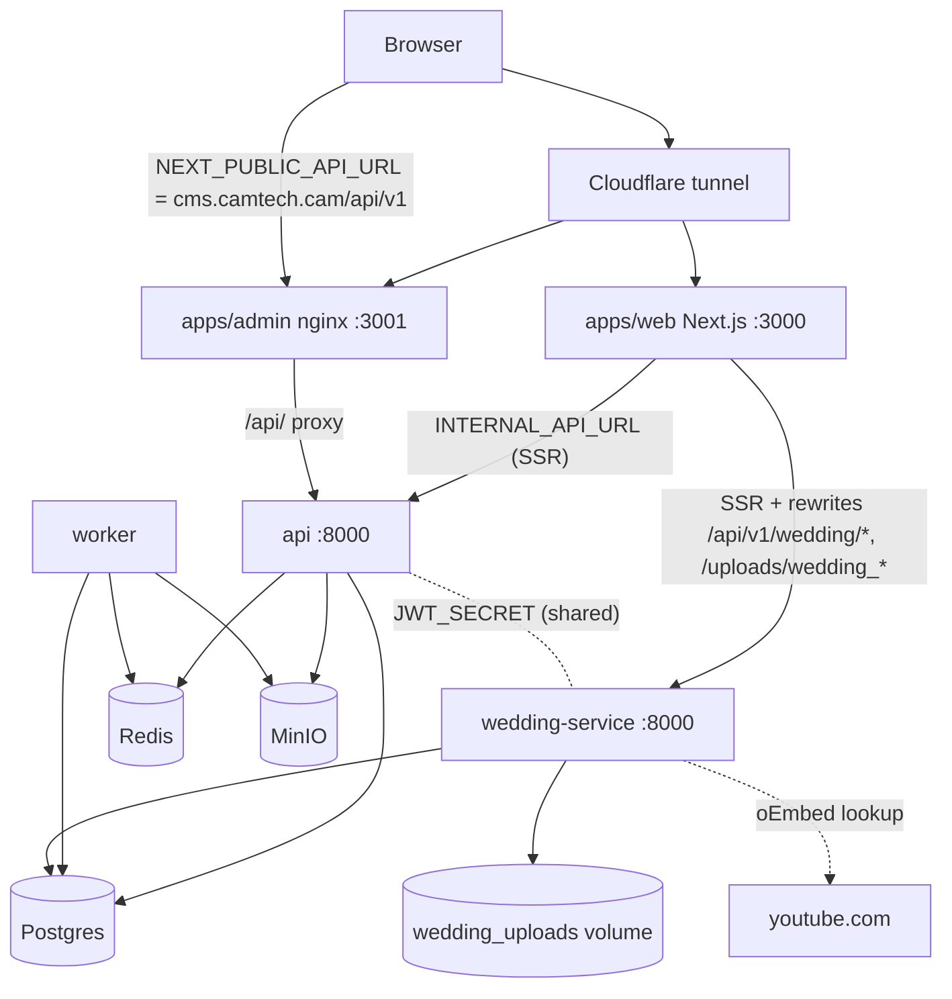

# CamTech ecosystem audit — 2026-10-24

Scope of this pass: the single repository in this workspace (`D:\Project\CamtectBlog`). It
prioritised confirmed security and data-integrity defects across service boundaries, with the
wedding platform as the priority business workflow. It is **not** a complete audit of every line;
section F lists what was not covered.

A second session was mid-way through an uncommitted wedding-platform overhaul in the same checkout
(`apps/wedding-service/*`, `apps/web/src/components/wedding/*`, wedding libs/types/routes). Edits
to those files in this pass were kept minimal and reported to that session.

---

## A. Inventory (verified from source)

| Component | Path | Stack | Entry point | Port (compose) | Responsibility |
|---|---|---|---|---|---|
| Web | `apps/web` | Next.js 16.3.5, React 19.2.8, TS | `next start` | `3000:3000` (all interfaces, intentional — tunnel ingress) | Public blog, travel, tools, wedding editor + public invitation; proxies `/api/v1/wedding/*` and `/uploads/wedding_*` to wedding-service via build-time rewrites |
| Admin | `apps/admin` | Vite 8, React 19, react-router 7, nginx | nginx static + `/api/` proxy | `3001:80` (all interfaces, intentional) | CMS SPA; its nginx is the **only public proxy** to the main API (`cms.camtech.cam/api/v1/*`) |
| API | `apps/api` | FastAPI, SQLAlchemy 2, Alembic, python-jose | `uvicorn app.main:app` | `127.0.0.1:8000` | Articles, discoveries, quizzes, travel, transport, admin, auth, storage config, AI gateway |
| Worker | `apps/api` (`Dockerfile.worker`) | Python, APScheduler | `python -m app.workers.runner` | none | Ingestion / scheduled jobs |
| Wedding service | `apps/wedding-service` | FastAPI, SQLAlchemy, bcrypt, python-jose | `uvicorn main:app` | `127.0.0.1:8002` | Wedding accounts, invitation cards, RSVP/wishes, uploads, curated music |
| Postgres 16 | compose | — | — | `127.0.0.1:5435` | Shared database: main API tables **and** `wedding_*` tables |
| Redis 7 | compose | password-protected | — | `127.0.0.1:6389` | API cache / rate limiting |
| MinIO | compose | — | — | `127.0.0.1:9000/9001` | API media storage |
| CI/CD | `.github/workflows/deploy.yml` | self-hosted runner on the production host | push to `main` | — | git reset → build → up → alembic → seed → health checks → auto-rollback |

Auth boundaries:
- Main API: HS256 JWT signed with `JWT_SECRET`; `get_current_user` looks the `sub` up in `users`; roles checked by `require_admin` / `require_infra_admin`.
- Wedding service: HS256 JWT signed with the **same** `JWT_SECRET`; requires `role == "WEDDING_USER"` and looks `sub` up in `wedding_users`. Cross-acceptance was checked: a main-API token has no `WEDDING_USER` role, and a wedding token's `sub` (uuid4 in `wedding_users`) does not resolve in `users`. There is no `aud` claim, so the separation rests on these lookups (see G).

Schema ownership: Alembic in `apps/api/migrations` creates the `wedding_*` tables (`002_add_wedding_tables`). The wedding service also calls `Base.metadata.create_all` on startup. Neither runs `ALTER`, so any **new** wedding column needs an Alembic migration in `apps/api`.

## B. Architecture

Wedding lifecycle traced: `POST /auth` (sign up or sign in, creates one draft card per account) → `GET/PUT /my-card` (owner edits, server-side validation of URLs/JSON/slug) → `is_published=true` → `GET /card/{slug}` (public; drafts 404) → `POST /card/{slug}/wish` (rate limited, honeypot, de-duplicated) → `GET /my-card/responses` (owner only: phone, attendance, headcount).

## C. Findings

| # | Sev | Component | Finding | Evidence | Status |
|---|---|---|---|---|---|
| 1 | **P0** | api ↔ wedding | A second, legacy `/api/v1/wedding` router in the main API served the same `wedding_*` tables and was publicly reachable through the admin nginx (`location /api/ → api`). It had no rate limit on `/auth` (unbounded password guessing against any couple's phone; 4-char minimum), no URL validation on `PUT /my-card` (stored `javascript:` / `data:` links that the public invitation renders), no slug validation (reserved paths, empty slug), and it created cards **published by default with a placeholder bank account** (`000 123 456 (ABA Bank)`) and a public QR. Public card responses also exposed every guest's attendance and headcount. | `apps/api/app/api/v1/wedding.py` (removed), `app/main.py`, `apps/admin/nginx.conf` | **Fixed**: router and its schemas removed; models kept so Alembic autogenerate never proposes dropping the tables. Regression test `tests/test_wedding_ownership.py`. |
| 2 | **P0** | CI/CD | `deploy.yml` appended literal `JWT_SECRET` and `SESSION_SECRET` values (plus weak Postgres/Redis/MinIO passwords) to the server `.env` whenever a key was missing. They are in git history since `b96b3b8` and are **not** on the API's burned-secret list, so if the server was ever seeded by this step, admin sessions are signed with a key anyone with repo access holds. | `.github/workflows/deploy.yml` Stage 1 | **Fixed in code**: the step now fails with the names of missing keys and writes no secret. Test `test_the_deploy_workflow_never_writes_a_secret_value` (fails on the old file, passes on the new). **Rotation on the server is still required — see F.** |
| 3 | P1 | wedding-service | Rate limits keyed on the first `X-Forwarded-For` entry, which the client controls; rotating it reset per-IP limits on `/auth` and wishes. | `security.py:client_ip` | **Fixed**: `CF-Connecting-IP` (overwritten by Cloudflare) first, matching `apps/api/app/common/audit.py`. Test `test_rotating_x_forwarded_for_does_not_reset_the_ip_limit`. |
| 4 | P1 | tests / deps | Under FastAPI ≥ 0.141 (what the unpinned `fastapi>=0.115.0` installs today, and what `apps/api/venv` has), included routers are nested `_IncludedRouter` entries. The admin-authz guard index walked only `app.routes`, came back empty, and 4 tests failed. Worse, any route-listing assertion would have passed vacuously. | `tests/test_admin_authz.py::_route_guards` | **Fixed**: the walker descends into included routers (and carries include-level dependencies) on both 0.135 and 0.141. |
| 5 | P2 | web | Public invitation rendered `evening_reception.map_url` as an `href` without checking the scheme. React 19 blocks `javascript:`, but rows written by the legacy router (#1) were never validated. | `PremierRoyalKhmerCard.tsx` | **Fixed**: shared `src/lib/safe-url.ts` used by the editor and the card; the link renders only for http(s) or relative URLs. |
| 6 | P2 | wedding-service | `/youtube-resolve` is unauthenticated and blocks a worker thread for up to 4 s per call on an outbound request. | `routes.py` | **Fixed**: 30 per 10 min per IP. |
| 7 | P2 | wedding-service | `/health` reports ok when the database is unreachable; there was no readiness signal. | `routes.py` | **Fixed**: `GET /api/v1/wedding/ready` runs `SELECT 1` and returns 503 on failure. Compose healthcheck intentionally left on `/health` (changing it alters restart behaviour; see G). |
| 8 | P2 | wedding-service | No `.dockerignore`; `COPY . .` shipped local SQLite databases and local uploads into the image. | Dockerfile | **Fixed**: `.dockerignore`. Root `.gitignore` now ignores `apps/wedding-service/uploads/`. |
| 9 | P2 | wedding-service | No automated tests at all. | — | **Fixed**: 19 tests (see E). |
| 10 | P2 | database | Postgres connection budget: api pool 30+50, worker (same module) 30+50, wedding 20+40 = up to 220 connections against Postgres's default `max_connections=100`. | `apps/api/app/common/database.py`, `apps/wedding-service/database.py` | **Open**: needs measured peak concurrency before resizing. |
| 11 | P2 | wedding schema | Wedding columns are created by Alembic in `apps/api` and by `create_all` in the wedding service; neither alters existing tables. Migration `002` sets `server_default is_published = 1` while the service now defaults to drafts (Python-side default, so new rows are correct; raw inserts would publish). | `migrations/versions/002_*`, `models.py` | **Open**: document that `apps/api` Alembic owns wedding DDL; add a migration if the server default should change. |
| 12 | P3 | web | ESLint baseline: 39 errors, 129 warnings across `apps/web/src` (mostly `react-hooks/set-state-in-effect`). None in the files changed here. | `npx eslint src` | Open |
| 13 | P3 | api tests | `test_ssrf_validator` resolves `www.reuters.com` over live DNS and failed once in the full run, then passed. | `tests/test_backend.py` | Open (network-dependent) |
| 14 | P3 | wedding auth | Wedding accounts are free to create and each can upload up to 120 × 8 MB images per hour with no per-account storage quota; uploads are not linked to a card, so replaced photos are never cleaned up. | `routes.py` upload handlers | Open |

## D. Changes made

| File | Change |
|---|---|
| `apps/api/app/main.py` | Unmounted the legacy wedding router, with a comment on why. |
| `apps/api/app/api/v1/wedding.py`, `apps/api/app/schemas/wedding.py` | Removed (`git rm`). `app/models/wedding.py` and migration `002` are kept. |
| `apps/api/tests/test_wedding_ownership.py` | New: no `/api/v1/wedding` route on the main API (via OpenAPI paths, version-independent); wedding tables stay in metadata. |
| `apps/api/tests/test_admin_authz.py` | Route-guard walker descends into FastAPI ≥ 0.141 nested routers. |
| `apps/api/tests/test_deploy_hygiene.py` | New test: the deploy workflow contains no literal secret value. |
| `.github/workflows/deploy.yml` | Stage 1 verifies required secrets and fails; no secret is written. |
| `apps/wedding-service/security.py` | `client_ip` prefers `CF-Connecting-IP`. |
| `apps/wedding-service/routes.py` | `/ready` endpoint; rate limit on `/youtube-resolve`. |
| `apps/wedding-service/.dockerignore` | New. |
| `apps/wedding-service/tests/` | New suite (`conftest.py`, `test_wedding_flows.py`). |
| `apps/web/src/lib/safe-url.ts` | New shared URL guard. |
| `apps/web/src/components/wedding/WeddingEditor.tsx` | Uses the shared guard (local copy removed). |
| `apps/web/src/components/wedding/PremierRoyalKhmerCard.tsx` | Map link only rendered for safe URLs. |
| `.gitignore` | Ignore `apps/wedding-service/uploads/`. |

No dependencies added. No migrations added or run. No production system touched.

## E. Test report

| Command | Result |
|---|---|
| `apps/api: venv/Scripts/python -m pytest tests` (FastAPI 0.141.1) | Baseline: 4 failed (finding #4). After: **337 passed** |
| `apps/api: python -m pytest tests` (system Python, FastAPI 0.135.1) | Baseline: 333 passed, 1 failed (#13, flaky). After: **337 passed** |
| `apps/wedding-service: python -m pytest tests` (both interpreters) | **19 passed** (new suite) |
| `apps/web: npx tsc --noEmit` | Baseline: 1 error from a stale `.next/types` entry for the deleted `/api/wedding/upload` route. After clearing `.next/types`: **0 errors** |
| `apps/web: npx eslint` on changed files | 0 errors, 12 pre-existing warnings |

Wedding scenarios covered: draft on first sign-in without bank details; same card on re-login; wrong password; per-phone brute-force limit across rotating IPs; XFF-rotation bypass blocked; no-token and wrong-role tokens refused; edits persist; publish/unpublish visibility; `javascript:` refused in cover, music, KHQR, gallery and map link; reserved/taken slugs; null cannot blank required fields; RSVP stored with phone and headcount visible only to the owner, public guestbook shows name + message only; double-submit stored once; honeypot not stored; no RSVP on drafts; one couple cannot delete another's responses; uploads need auth and a real image (HTML-as-PNG refused); readiness.

**Not run**: `next build` (another session's dev server was using the same `.next` directory), browser/E2E testing of the invitation and editor (the other session owns that UI mid-change), admin SPA build, Docker image builds, anything against staging/production.

## F. Remaining risks and actions that need you

1. **Rotate `JWT_SECRET` and `SESSION_SECRET` on the production server** if its `.env` holds the values that were in `deploy.yml` (compare on the server; do not paste them anywhere). Rotation signs every admin and couple out. Then add the old values to `_BURNED_SECRETS` in `apps/api/app/common/config.py` so they can never be used again. Do the same for the Postgres/Redis/MinIO passwords if they match the old fallbacks. Note that adding to the burned list before rotating will stop the API from starting.
2. The removed legacy router may have written rows that bypassed validation (unsafe URLs, published cards with the placeholder bank account `000 123 456 (ABA Bank)` / `CHEA VISAL & SOK SOVANNARY`). A read-only query on production would tell: `SELECT slug, is_published FROM wedding_cards WHERE khqr_account_number = '000 123 456 (ABA Bank)'` and a scan for non-http(s) URL columns. Not run — no production access, and any cleanup should be decided by you.
3. Not audited in this pass: admin SPA pages and CRUD flows, travel/transport/ingestion/AI-gateway business logic, the worker's job lifecycle, performance (no measurements taken, so no performance claims are made), the 3D invitation in a real browser, mobile and reduced-motion behaviour.
4. Pin `fastapi` (and other unpinned deps) in both `requirements.txt` files so the production image matches what the tests ran against.

## G. Operational recommendations

- Point the wedding-service compose healthcheck (or a separate readiness probe in the deploy script) at `/api/v1/wedding/ready`, and add a wedding-service check to Stage 5 of `deploy.yml`. Today the pipeline never checks the wedding service.
- Add `aud`/`iss` claims (or separate signing keys) for main-API and wedding tokens so the service boundary does not rest on table lookups alone.
- Right-size DB pools against measured concurrency or raise `max_connections` (#10).
- Run the wedding-service tests in CI. The current pipeline runs no tests even though its header comment lists lint and test stages.
- Make `apps/api` Alembic the single owner of wedding DDL and drop `create_all` from the wedding service once a migration path is agreed.
